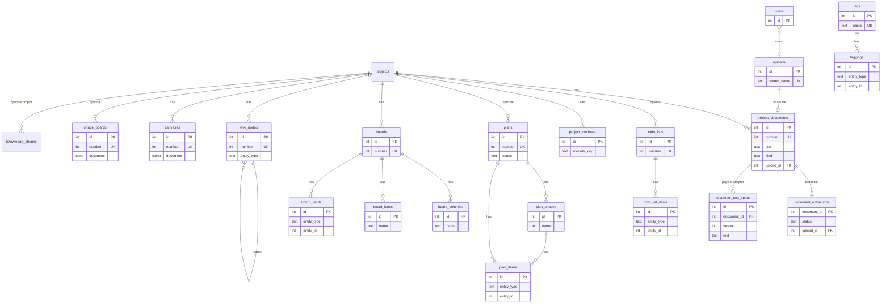

# Content and modules

Project content surfaces: documents, uploads, tags, todo lists, module toggles, plans, Kanban boards, wiki TOC, Excalidraw canvases, and image boards. Source: [`src/db/schema.ts`](../../src/db/schema.ts).

Related: [overview](overview.md) · [projects and ideas](projects-and-ideas.md) · [glossary](glossary.md)

## Logical model

Polymorphic targets (`taggings`, `todo_list_items`, `board_cards`, `wiki_nodes`) use `entity_type` + `entity_id` without a database FK to the target row. See [glossary](glossary.md#polymorphic-entity-links).

---

## `project_documents`

Standalone project documents. Display number → **N####** (documents previously used D####; D is now ToDos).

Kinds:

- **`markdown`** (default) — TipTap Markdown `body`
- **`epub`** — binary EPUB on disk via `upload_id` → `uploads` (bytes under `UPLOAD_DIR`; not stored in Postgres)
- **`pdf`** — binary PDF on disk via `upload_id` → `uploads` (same storage pattern as EPUB)

### Columns

| Column | Type | Nullable | Default | Notes |
|--------|------|----------|---------|--------|
| `id` | serial | no | — | Primary key |
| `number` | integer | no | — | Display number (N####) |
| `project_id` | integer | no | — | FK → `projects.id` |
| `title` | text | no | — | |
| `body` | text | yes | — | Markdown when `kind=markdown`; null for `epub` / `pdf` |
| `kind` | text | no | `'markdown'` | `markdown` \| `epub` \| `pdf` |
| `upload_id` | integer | yes | — | FK → `uploads.id` for binary kinds |
| `position` | integer | no | `0` | Ordering within the project |
| `updated_by_id` | integer | yes | — | FK → `users.id` — last editor |
| `created_at` | timestamptz | no | `now()` | |
| `updated_at` | timestamptz | no | `now()` | |

### Constraints

- **PK:** `id`
- **UNIQUE:** `number`
- **FK:** `project_id` → `projects.id` · **ON DELETE CASCADE**
- **FK:** `upload_id` → `uploads.id` · **ON DELETE SET NULL**
- **FK:** `updated_by_id` → `users.id` · **ON DELETE SET NULL**

---

## `document_extractions`

One row per project document that has had text extraction queued. PDF and EPUB text is **not** stored in `project_documents.body`. Markdown documents do not use this table.

`status`: `pending` (queued or running) · `ready` (text stored) · `empty` (file parsed, no text layer — scanned PDF or an EPUB with no chapter text; OCR is not run) · `failed`.

### Columns

| Column | Type | Nullable | Default | Notes |
|--------|------|----------|---------|--------|
| `document_id` | integer | no | — | PK, FK → `project_documents.id` |
| `upload_id` | integer | yes | — | FK → `uploads.id` — file this row describes |
| `status` | text | no | `'pending'` | `pending` \| `ready` \| `empty` \| `failed` |
| `error_message` | text | yes | — | Failure text, or the empty-file note |
| `unit_count` | integer | no | `0` | PDF page count or EPUB chapter count |
| `char_count` | integer | no | `0` | Stored characters |
| `truncated` | boolean | no | `false` | Stopped at the page/chapter or character limit |
| `updated_at` | timestamptz | no | `now()` | |

### Constraints

- **PK:** `document_id`
- **FK:** `document_id` → `project_documents.id` · **ON DELETE CASCADE**
- **FK:** `upload_id` → `uploads.id` · **ON DELETE SET NULL**
- **CHECK:** `status` in `pending`, `ready`, `empty`, `failed`

---

## `document_text_spans`

One row per PDF page or EPUB spine item that contained text, in reading order. `locator` is the 1-based page number or spine index used for citations.

### Columns

| Column | Type | Nullable | Default | Notes |
|--------|------|----------|---------|--------|
| `id` | serial | no | — | Primary key |
| `document_id` | integer | no | — | FK → `project_documents.id` |
| `ordinal` | integer | no | — | Reading order among stored spans |
| `locator` | integer | no | — | 1-based page or chapter index |
| `label` | text | no | — | `Page N` or the chapter title |
| `text` | text | no | — | Extracted text for that locator |

### Constraints

- **PK:** `id`
- **UNIQUE:** (`document_id`, `ordinal`)
- **INDEX:** (`document_id`, `locator`)
- **FK:** `document_id` → `project_documents.id` · **ON DELETE CASCADE**

---

## `knowledge_chunks`

Full-text and optional embedding pieces for ideas, projects, tasks, todos, documents, todo lists, boards, canvases, wiki nodes, and image boards. A chunk is a slice of a title, a Markdown body, a comment, or one extracted PDF page / EPUB chapter. Search checks who can see the source record at query time. Projects whose effective AI access is excluded keep full-text rows and store no embedding.

There is no foreign key to the source record (the link is `entity_type` + `entity_id`). Deleting a record removes its chunks in the app, and a nightly job drops rows whose source is gone. `project_id` does cascade when that project is deleted. `source_id` is `0` for the record’s own title or body, an activity id for a comment, or a `document_text_spans.id` for extracted text.

Embeddings are 768-dimensional vectors from the configured Ollama embedding model. The `vector` extension has to be installed (`postgresql-<major>-pgvector` on Ubuntu; the Compose database image includes it).

### Columns

| Column | Type | Nullable | Default | Notes |
|--------|------|----------|---------|--------|
| `id` | serial | no | — | Primary key |
| `entity_type` | text | no | — | Same entity types as other polymorphic links |
| `entity_id` | integer | no | — | Source record id |
| `project_id` | integer | yes | — | FK → `projects.id` when the record belongs to a project |
| `source` | text | no | — | `title` \| `body` \| `comment` \| `extraction` |
| `source_id` | integer | no | `0` | `0` for title/body; activity or span id otherwise |
| `chunk_index` | integer | no | — | Order within that source |
| `heading` | text | yes | — | Markdown heading or extraction label |
| `locator` | integer | yes | — | 1-based page or chapter; null for Markdown |
| `start_offset` | integer | no | `0` | Character offset in the source text |
| `end_offset` | integer | no | `0` | Character offset in the source text |
| `content` | text | no | — | Chunk text |
| `content_tsv` | tsvector | no | — | `simple` dictionary, for keyword search |
| `content_hash` | text | no | — | Hash of `content`; unchanged text is not re-embedded |
| `embedding` | vector(768) | yes | — | Null when the project is excluded from AI, or when embedding has not run |
| `embedding_model` | text | yes | — | Ollama model name that produced `embedding` |
| `updated_at` | timestamptz | no | `now()` | |

### Constraints

- **PK:** `id`
- **UNIQUE:** (`entity_type`, `entity_id`, `source`, `source_id`, `chunk_index`)
- **INDEX:** (`entity_type`, `entity_id`), `project_id`, GIN on `content_tsv`, HNSW cosine on `embedding` where it is not null
- **FK:** `project_id` → `projects.id` · **ON DELETE CASCADE**
- **CHECK:** `entity_type` is a canonical entity type
- **CHECK:** `source` in `title`, `body`, `comment`, `extraction`

---

## `uploads`

Stored image and document files on disk. Metadata only in Postgres; bytes live under `UPLOAD_DIR` (default `data/uploads/`). Included in backup `uploads-*.tar.gz`.

Allowed types: jpeg/png/gif/webp (default max 5 MiB via `UPLOAD_MAX_BYTES`) and binary documents EPUB (`application/epub+zip`) / PDF (`application/pdf`) (default max 100 MiB via `UPLOAD_MAX_BYTES_BINARY`, with `UPLOAD_MAX_BYTES_EPUB` as legacy fallback).

### Columns

| Column | Type | Nullable | Default | Notes |
|--------|------|----------|---------|--------|
| `id` | serial | no | — | Primary key |
| `stored_name` | text | no | — | On-disk filename (UUID + extension) |
| `original_name` | text | no | — | Client filename |
| `mime_type` | text | no | — | |
| `size_bytes` | integer | no | — | |
| `owner_id` | integer | no | — | FK → `users.id` — record owner (T0112) |
| `created_at` | timestamptz | no | `now()` | |

### Constraints

- **PK:** `id`
- **UNIQUE:** `stored_name`
- **FK:** `owner_id` → `users.id` · **ON DELETE RESTRICT**

### Relationships

- Referenced by `users.avatar_upload_id` (`ON DELETE SET NULL`) — see [platform](platform.md).

---

## `tags` / `taggings`

Per-user tag catalog (T0112) plus polymorphic attachments.

### `tags` columns

| Column | Type | Nullable | Default | Notes |
|--------|------|----------|---------|--------|
| `id` | serial | no | — | Primary key |
| `name` | text | no | — | Label unique **per owner** |
| `color` | text | yes | — | Accent |
| `owner_id` | integer | no | — | FK → `users.id` — tag owner (T0112) |
| `created_at` | timestamptz | no | `now()` | |

**Constraints:** PK `id`; UNIQUE `(owner_id, name)` — `tags_owner_id_name_uidx`; FK `owner_id` → `users.id` · **ON DELETE RESTRICT**. Referenced by `task_groups.auto_tag_id` (`ON DELETE SET NULL`).

### `taggings` columns

| Column | Type | Nullable | Default | Notes |
|--------|------|----------|---------|--------|
| `id` | serial | no | — | Primary key |
| `tag_id` | integer | no | — | FK → `tags.id` |
| `entity_type` | text | no | — | Canonical `EntityType` string |
| `entity_id` | integer | no | — | Target row id (no DB FK) |

**Constraints:**

- **PK:** `id`
- **UNIQUE:** `(tag_id, entity_type, entity_id)` — `taggings_tag_entity_uidx`
- **FK:** `tag_id` → `tags.id` · **ON DELETE CASCADE**

---

## `entity_links`

Directed links between any two records (T0160). Ends are polymorphic `(type, id)` pairs, so there is no foreign key to the target row. Structural relations (project membership, task dependencies, tags, list and board membership) stay on their own tables. `AFTER DELETE` triggers on each entity table remove links when a row is hard-deleted, including cascade deletes from a project.

### Columns

| Column | Type | Nullable | Default | Notes |
|--------|------|----------|---------|--------|
| `id` | serial | no | — | Primary key |
| `src_type` | text | no | — | Source `EntityType` |
| `src_id` | integer | no | — | Source row id (no DB FK) |
| `dst_type` | text | no | — | Destination `EntityType` |
| `dst_id` | integer | no | — | Destination row id (no DB FK) |
| `relation` | text | no | `'relates_to'` | `relates_to` · `references` · `supports` · `part_of` · `duplicate_of` |
| `origin` | text | no | `'manual'` | `manual` · `mention` |
| `created_by_id` | integer | no | — | FK → `users.id` |
| `created_at` | timestamptz | no | `now()` | |

**Constraints:**

- **PK:** `id`
- **UNIQUE:** `(src_type, src_id, dst_type, dst_id, relation, origin)` — `entity_links_pair_uidx`
- **INDEX:** `(src_type, src_id)` — `entity_links_src_idx`; `(dst_type, dst_id)` — `entity_links_dst_idx`
- **CHECK:** both types are canonical `EntityType` values; relation and origin are the lists above; source and destination are not the same row
- **FK:** `created_by_id` → `users.id` · **ON DELETE RESTRICT**

---

## `todos`

First-class **ToDo** records (UI label “ToDo”). Display number → **D####**. Lighter than Task: due date, optional quarter-hour `estimate_hours`, priority, Task-parity state, `action_by` datetime, and a stored `progress` percent (0–100). Optional `project_id` and `source_idea_id` (when converted from an Idea). Soft-delete via `state = 'deleted'`.

Hierarchy is `parent_id` on the ToDo (same idea as tasks). A parent with any non-deleted sub-item stores a **derived** progress: **x of y** direct children complete, where canceled and deleted children are left out of both counts, and the percent is `round(100 * x / y)`. Marking that parent complete while a child is still open stores **Pending** and keeps the rollup percent. When every direct child is finished, a Pending parent becomes **Complete** at 100%. Completing children does not auto-complete a parent left in Draft, Ready, or In Progress. A list indents a child only when the parent is also on that list.

### Columns

| Column | Type | Nullable | Default | Notes |
|--------|------|----------|---------|--------|
| `id` | serial | no | — | Primary key |
| `project_id` | integer | yes | — | FK → `projects.id`; null = unassigned |
| `number` | integer | no | — | Display number (D####) |
| `title` | text | no | — | |
| `description` | text | yes | — | Markdown notes |
| `state` | text | no | `'new'` | Same values as `tasks.state` |
| `priority` | text | no | `'none'` | Same values as `tasks.priority` |
| `due_date` | date | yes | — | Date-only due |
| `start_date` | date | yes | — | Schedule hint (`YYYY-MM-DD`). Does not block In Progress. Null means no constraint. Must be on or before `due_date` when both are set |
| `estimate_hours` | numeric(6,2) | yes | — | Effort estimate in hours. Null = not estimated. 0 = trivial. Quarter-hour steps only. Drizzle `mode: "number"` maps the driver string to a JSON number |
| `action_by` | timestamptz | yes | — | When to act |
| `color` | text | yes | — | |
| `sort_order` | integer | no | `0` | |
| `source_idea_id` | integer | yes | — | FK → `ideas.id` · ON DELETE SET NULL |
| `created_by_id` | integer | no | — | FK → `users.id` · ON DELETE RESTRICT |
| `updated_by_id` | integer | no | — | FK → `users.id` · ON DELETE RESTRICT |
| `owner_id` | integer | no | — | FK → `users.id` — record owner (T0112) |
| `assignee_id` | integer | yes | — | FK → `users.id` — assigned user (T0117); same pool rules as tasks when `project_id` is set |
| `progress` | integer | no | `0` | Percent complete, 0–100. User-set on a ToDo with no sub-items (T0155). On a parent, the derived rollup (T0097) |
| `parent_id` | integer | yes | — | Self-FK → `todos.id`. Sub-item parent. Null = top-level |
| `created_at` | timestamptz | no | `now()` | |
| `updated_at` | timestamptz | no | `now()` | |

**Constraints:** PK `id`; UNIQUE `number`; CHECK `todos_progress_range` (`progress` between 0 and 100); CHECK `todos_estimate_hours_quarter` (`estimate_hours >= 0` and a whole number of quarter hours; null passes; the API also caps the value at 999.75); CHECK `todos_start_not_after_due` (`start_date` is null, `due_date` is null, or `start_date <= due_date`); FKs as above (`assignee_id` · **ON DELETE SET NULL**); `parent_id` → `todos.id` · **ON DELETE SET NULL**; index `todos_parent_id_idx`.

---

## `todo_lists` / `todo_list_items`

Checklist containers (standalone or project-scoped) with polymorphic rows. Display number → **L####**.

New memberships use **`todo`** or **`task`**. Legacy **`idea`** rows may remain (no automatic migration); Ideas are managed on the Ideas UI.

### `todo_lists` columns

| Column | Type | Nullable | Default | Notes |
|--------|------|----------|---------|--------|
| `id` | serial | no | — | Primary key |
| `number` | integer | no | — | Display number (L####) |
| `project_id` | integer | yes | — | FK → `projects.id`; null = standalone |
| `title` | text | no | — | |
| `kind` | text | no | `'list'` | List kind discriminator |
| `owner_id` | integer | no | — | FK → `users.id` — record owner (T0112) |
| `created_at` | timestamptz | no | `now()` | |
| `updated_at` | timestamptz | no | `now()` | |

**Constraints:** PK `id`; UNIQUE `number`; FK `project_id` → `projects.id` · **ON DELETE CASCADE**; FK `owner_id` → `users.id` · **ON DELETE RESTRICT**.

### `todo_list_items` columns

| Column | Type | Nullable | Default | Notes |
|--------|------|----------|---------|--------|
| `id` | serial | no | — | Primary key |
| `list_id` | integer | no | — | FK → `todo_lists.id` |
| `entity_type` | text | no | — | Polymorphic type (`todo` \| `task`; legacy `idea`) |
| `entity_id` | integer | no | — | Polymorphic id |
| `sort_order` | integer | no | `0` | |
| `checked` | boolean | no | `false` | |
| `created_at` | timestamptz | no | `now()` | |
| `updated_at` | timestamptz | no | `now()` | |

**Constraints:**

- **PK:** `id`
- **UNIQUE:** `(list_id, entity_type, entity_id)` — `todo_list_items_list_entity_uidx`
- **FK:** `list_id` → `todo_lists.id` · **ON DELETE CASCADE**

---

## `project_modules`

Per-project enablement and ordering of hub modules (tasks, wiki, boards, …).

### Columns

| Column | Type | Nullable | Default | Notes |
|--------|------|----------|---------|--------|
| `id` | serial | no | — | Primary key |
| `project_id` | integer | no | — | FK → `projects.id` |
| `module_key` | text | no | — | Module identifier string |
| `enabled` | boolean | no | `true` | |
| `sort_order` | integer | no | `0` | |
| `created_at` | timestamptz | no | `now()` | |
| `updated_at` | timestamptz | no | `now()` | |

### Constraints

- **PK:** `id`
- **UNIQUE:** `(project_id, module_key)` — `project_modules_project_key_uidx`
- **FK:** `project_id` → `projects.id` · **ON DELETE CASCADE**

Known `module_key` values include `tasks`, `documents`, `todo_lists`, `boards`, `wiki`, `canvases`, `mesh`, and `plans`. New projects receive a `plans` row with `enabled` false. Existing projects receive that row from the T0309 migration.

---

## Plans (`plans`, `plan_phases`, `plan_items`)

An ordered, phased sequence of Tasks and ToDos (T0309). Display number → **PL####**. A plan may belong to a project or stand alone (`project_id` null). Phases belong to the plan. `tasks.phase_id` is the separate project-level phase and is not used here. An item may be in any number of plans, once per plan.

### `plans`

| Column | Type | Nullable | Default | Notes |
|--------|------|----------|---------|--------|
| `id` | serial | no | — | Primary key |
| `number` | integer | no | — | Display number (PL####), app-wide unique |
| `project_id` | integer | yes | — | FK → `projects.id` · CASCADE. Null = standalone |
| `title` | text | no | — | |
| `description` | text | yes | — | |
| `status` | text | no | `draft` | `draft` · `active` · `complete` · `archived` |
| `target_date` | date | yes | — | |
| `start_date` | date | yes | — | Schedule anchor. Null means a later schedule treats the anchor as today. Must be on or before `target_date` when both are set |
| `workday_hours` | numeric(4,2) | no | `8` | Working-day length for later duration (hours ÷ workday). Quarter-hours from 0.25 through 24 |
| `capacity_hours_per_week` | numeric(5,2) | yes | — | Used when completion history is too short to project a finish |
| `revision` | integer | no | `0` | Optimistic lock for later reorders |
| `owner_id` | integer | no | — | FK → `users.id` · RESTRICT |
| `created_by_id` | integer | no | — | FK → `users.id` · RESTRICT |
| `updated_by_id` | integer | no | — | FK → `users.id` · RESTRICT |
| `created_at` | timestamptz | no | `now()` | |
| `updated_at` | timestamptz | no | `now()` | |

### `plan_phases`

| Column | Type | Nullable | Default | Notes |
|--------|------|----------|---------|--------|
| `id` | serial | no | — | Primary key |
| `plan_id` | integer | no | — | FK → `plans.id` · CASCADE |
| `name` | text | no | — | |
| `color` | text | yes | — | |
| `sort_order` | integer | no | `0` | |
| `created_at` | timestamptz | no | `now()` | |
| `updated_at` | timestamptz | no | `now()` | |

### `plan_items`

| Column | Type | Nullable | Default | Notes |
|--------|------|----------|---------|--------|
| `id` | serial | no | — | Primary key |
| `plan_id` | integer | no | — | FK → `plans.id` · CASCADE |
| `phase_id` | integer | no | — | FK → `plan_phases.id` · RESTRICT |
| `entity_type` | text | no | — | `task` or `todo` |
| `entity_id` | integer | no | — | No foreign key; hard deletes are purged by trigger |
| `sort_order` | integer | no | `0` | |
| `created_at` | timestamptz | no | `now()` | |

### Constraints

- **UNIQUE:** `plans.number`. `plan_items` unique on `(plan_id, entity_type, entity_id)` — `plan_items_plan_entity_uidx`.
- **CHECK:** `plans.status` is `draft`, `active`, `complete`, or `archived`. `plans_start_not_after_target` requires `start_date` null, `target_date` null, or `start_date <= target_date`. `plans_workday_hours_quarter` requires `workday_hours` from 0.25 through 24 in quarter-hour steps. `plan_items.entity_type` is `task` or `todo`.
- **INDEX:** `plan_items_order_idx` on `(plan_id, phase_id, sort_order)`. `plan_items_entity_idx` on `(entity_type, entity_id)`.
- **DELETE:** Removing a plan cascades to its phases and items, and triggers purge matching `task_activity` and `entity_links` rows. Removing a phase is refused while it still has items. Hard-deleting a Task or ToDo removes its `plan_items` rows. Soft-deleted items stay in the plan.

---

## Boards (`boards`, `board_columns`, `board_lanes`, `board_cards`)

Kanban planning boards (multiple per project). Display number → **B####**. Cards point at entities (typically tasks) via polymorphism.

### `boards`

| Column | Type | Nullable | Default | Notes |
|--------|------|----------|---------|--------|
| `id` | serial | no | — | Primary key |
| `number` | integer | no | — | Display number (B####) |
| `project_id` | integer | no | — | FK → `projects.id` · CASCADE |
| `name` | text | no | — | |
| `sort_order` | integer | no | `0` | |
| `created_at` | timestamptz | no | `now()` | |
| `updated_at` | timestamptz | no | `now()` | |

### `board_columns`

| Column | Type | Nullable | Default | Notes |
|--------|------|----------|---------|--------|
| `id` | serial | no | — | Primary key |
| `board_id` | integer | no | — | FK → `boards.id` · CASCADE |
| `name` | text | no | — | |
| `sort_order` | integer | no | `0` | |
| `wip_limit` | integer | yes | — | Optional WIP limit |
| `created_at` / `updated_at` | timestamptz | no | `now()` | |

### `board_lanes`

| Column | Type | Nullable | Default | Notes |
|--------|------|----------|---------|--------|
| `id` | serial | no | — | Primary key |
| `board_id` | integer | no | — | FK → `boards.id` · CASCADE |
| `name` | text | no | — | |
| `sort_order` | integer | no | `0` | |
| `created_at` / `updated_at` | timestamptz | no | `now()` | |

### `board_cards`

| Column | Type | Nullable | Default | Notes |
|--------|------|----------|---------|--------|
| `id` | serial | no | — | Primary key |
| `board_id` | integer | no | — | FK → `boards.id` · CASCADE |
| `column_id` | integer | no | — | FK → `board_columns.id` · CASCADE |
| `lane_id` | integer | yes | — | FK → `board_lanes.id` · **SET NULL** |
| `entity_type` | text | no | — | Polymorphic type |
| `entity_id` | integer | no | — | Polymorphic id |
| `sort_order` | integer | no | `0` | |
| `created_at` / `updated_at` | timestamptz | no | `now()` | |

**Unique:** `(board_id, entity_type, entity_id)` — `board_cards_board_entity_uidx` (one card per entity per board).

---

## `wiki_nodes`

Nested wiki table-of-contents nodes pointing at documents or canvases (via polymorphism). Display number → **W####**.

### Columns

| Column | Type | Nullable | Default | Notes |
|--------|------|----------|---------|--------|
| `id` | serial | no | — | Primary key |
| `number` | integer | no | — | Display number (W####) |
| `project_id` | integer | no | — | FK → `projects.id` · CASCADE |
| `parent_id` | integer | yes | — | Self-FK · **ON DELETE CASCADE** |
| `entity_type` | text | no | — | Target type (`document`, `canvas`, …) |
| `entity_id` | integer | no | — | Target id |
| `title` | text | no | — | TOC label |
| `sort_order` | integer | no | `0` | |
| `pinned` | boolean | no | `false` | |
| `created_at` / `updated_at` | timestamptz | no | `now()` | |

### Constraints

- **UNIQUE:** `number`
- **UNIQUE:** `(project_id, entity_type, entity_id)` — `wiki_nodes_project_entity_uidx`

---

## `canvases`

Freeform Excalidraw documents scoped to a project. Display number → **C####**.

### Columns

| Column | Type | Nullable | Default | Notes |
|--------|------|----------|---------|--------|
| `id` | serial | no | — | Primary key |
| `number` | integer | no | — | Display number (C####) |
| `project_id` | integer | no | — | FK → `projects.id` · CASCADE |
| `title` | text | no | — | |
| `sort_order` | integer | no | `0` | |
| `document` | jsonb | no | `{}` | Excalidraw scene JSON |
| `created_at` / `updated_at` | timestamptz | no | `now()` | |

**Constraints:** PK `id`; UNIQUE `number`.

---

## `image_boards`

PureRef-style image boards; optional project association. Display number → **M####**.

### Columns

| Column | Type | Nullable | Default | Notes |
|--------|------|----------|---------|--------|
| `id` | serial | no | — | Primary key |
| `number` | integer | no | — | Display number (M####) |
| `project_id` | integer | yes | — | FK → `projects.id` · **ON DELETE SET NULL** |
| `title` | text | no | — | |
| `sort_order` | integer | no | `0` | |
| `document` | jsonb | no | `{}` | Scene JSON (camera, items, …) |
| `owner_id` | integer | no | — | FK → `users.id` — record owner (T0112) |
| `created_at` / `updated_at` | timestamptz | no | `now()` | |

**Constraints:** PK `id`; UNIQUE `number`; FK `owner_id` → `users.id` · **ON DELETE RESTRICT**.
