# Database schema overview

TaskMesh stores application data in **PostgreSQL**. The application maps tables with **Drizzle ORM** in [`src/db/schema.ts`](../../src/db/schema.ts). Migrations live under [`drizzle/`](../../drizzle/).

This documentation is for administrators and developers. It is deliberately human-readable (no SQL dumps). Physical detail for **main domain** tables appears on the domain pages; **platform / non-main** tables are listed in [platform.md](platform.md) and appear only as compact nodes on diagrams.

## How to read these docs

| Layer | Where | What you get |
|-------|--------|----------------|
| **Conceptual** | This page | Broad product relationships |
| **Logical** | Domain pages | Entities, key attributes, exact foreign keys |
| **Physical** | Domain pages (main tables) | Column types, nullability, defaults, uniques / delete behavior |

Start here, then open the domain page for the area you are changing. Shared terms are in the [glossary](glossary.md).

## Main vs non-main tables

**Main domain** (full physical documentation):

`ideas`, `projects`, `task_groups`, `task_group_members`, `project_phases`, `project_managers`, `project_members`, `project_viewers`, `project_manager_groups`, `project_member_groups`, `project_viewer_groups`, `tasks`, `todos`, `task_activity`, `task_dependencies`, `task_description_templates`, `project_documents`, `document_extractions`, `document_text_spans`, `knowledge_chunks`, `uploads`, `tags`, `taggings`, `entity_links`, `todo_lists`, `todo_list_items`, `project_modules`, `boards`, `board_columns`, `board_lanes`, `board_cards`, `wiki_nodes`, `canvases`, `image_boards`

**Non-main** (inventory + minimal on diagrams):

`users`, `sessions`, `mfa_login_challenges`, `mfa_trusted_devices`, `oauth_providers`, `user_identities`, `oauth_login_states`, `password_history`, `roles`, `user_roles`, `api_keys`, `system_properties`, `entity_fields`, `user_list_view_prefs`, `user_task_list_state`, `user_project_overview_prefs`, `mesh_layouts`, `api_request_logs`, `ai_audit_log`, `ai_undo_journal`, `ai_instance_credentials`, `user_ai_credentials`, `user_ai_route_prefs`, `ai_output_feedback`, `ai_tag_suggestions`, `ai_duplicate_pairs`, `attention_digests`, `db_stats_snapshots`

## Conceptual model

At a high level, a **Project** is the hub. An **Idea** can become a project or a **ToDo**. **ToDos** (display **D####**) are first-class scheduled items lighter than Tasks. Projects own task groups, project phases, role lists (managers / members / viewers — access enforced in T0128), tasks, todos, documents, module toggles, boards, wiki nodes, and canvases. Tasks and ToDos may also exist outside a project. **To Do lists** hold ToDo and Task memberships (legacy Idea rows may remain). Tags attach via polymorphic `(entity_type, entity_id)` pairs. **`entity_links`** stores directed links between any two records (manual, and later mentions) without copying the structural relations already on other tables. **`knowledge_chunks`** stores full-text and optional embeddings for those records (titles, bodies, comments, and extracted PDF/EPUB text). **`task_activity`** is the shared timeline for those records: task rows still cascade with the task, and ToDo, Project, Document, and ToDo List rows use the same `(entity_type, entity_id)` key. List comments are stored on the list. A list's last update is still taken from its members. Users and API keys support authorship and future auth; they are not the focus of product modeling.

```mermaid
erDiagram
  ideas ||--o| projects : "sourceIdea"
  ideas ||--o{ todos : "sourceIdea"
  projects ||--o{ task_groups : has
  task_groups ||--o{ task_group_members : "manual members"
  tasks ||--o{ task_group_members : "manual groups"
  projects ||--o{ project_phases : has
  projects ||--o{ project_managers : "role list"
  projects ||--o{ project_members : "role list"
  projects ||--o{ project_viewers : "role list"
  projects ||--o{ tasks : "may own"
  projects ||--o{ todos : "may own"
  projects ||--o{ project_documents : has
  project_documents ||--o| document_extractions : extraction
  project_documents ||--o{ document_text_spans : "page or chapter"
  projects ||--o{ todo_lists : "may own"
  projects ||--o{ project_modules : has
  projects ||--o{ boards : has
  projects ||--o{ wiki_nodes : has
  projects ||--o{ canvases : has
  projects ||--o{ image_boards : "optional"
  projects ||--o{ task_description_templates : "may own"

  tasks ||--o{ tasks : "parent"
  todos ||--o{ todos : "parent"
  tasks ||--o{ task_activity : "task rows"
  tasks ||--o{ task_dependencies : "depends on / required by"

  boards ||--o{ board_columns : has
  boards ||--o{ board_lanes : has
  boards ||--o{ board_cards : has
  todo_lists ||--o{ todo_list_items : has
  tags ||--o{ taggings : has
  users ||--o{ entity_links : createdBy
  task_groups }o--o| tags : "auto_tag"
  wiki_nodes ||--o{ wiki_nodes : "parent"

  users ||--o{ tasks : "createdBy / updatedBy / owner / assignee"
  users ||--o{ todos : "createdBy / updatedBy / owner / assignee"
  users ||--o{ project_managers : "listed"
  users ||--o{ project_members : "listed"
  users ||--o{ project_viewers : "listed"
  users ||--o{ api_keys : has
  users ||--o{ user_roles : has
  roles ||--o{ user_roles : granted
  api_keys ||--o{ api_request_logs : "optional"
  users ||--o{ api_request_logs : "optional"
  users ||--o{ ai_audit_log : "assistant calls"
  users ||--o{ ai_undo_journal : "automatic changes"
  ai_audit_log ||--o{ ai_undo_journal : "optional"
  users ||--o{ ai_instance_credentials : "updated by"
  users ||--o{ user_ai_credentials : owns
  users ||--o{ user_ai_route_prefs : "model choice"
  ai_audit_log ||--o{ ai_output_feedback : "quality signals"
  users ||--o{ ai_tag_suggestions : "tag suggestions"
  users ||--o{ ai_duplicate_pairs : "duplicate warnings"
  users ||--o{ attention_digests : "attention digests"
  users }o--o| uploads : avatar
  system_properties }|..|{ system_properties : "key-value"
  users ||--o{ user_list_view_prefs : "list columns"
  users ||--o| user_task_list_state : "list collapse"
  users ||--o{ mesh_layouts : "mesh pins"
  entity_fields }|..|{ entity_fields : "field catalog"

  projects {
    string name
  }
  ideas {
    string title
  }
  tasks {
    string title
  }
  users {
    string displayName
  }
  roles {
    string slug
  }
  api_keys {
    string prefix
  }
  system_properties {
    string key
  }
  api_request_logs {
    string outcome
  }
  ai_audit_log {
    string action
  }
  ai_undo_journal {
    string status
  }
  ai_instance_credentials {
    string plugin_id
  }
  user_ai_credentials {
    int user_id FK
    string plugin_id
  }
  user_ai_route_prefs {
    int user_id FK
    string feature
  }
  ai_output_feedback {
    string kind
  }
  ai_tag_suggestions {
    string status
  }
  ai_duplicate_pairs {
    string status
  }
  attention_digests {
    string period_key
  }
```

Non-main entities (`users`, `sessions`, `password_history`, `roles`, `user_roles`, `api_keys`, `system_properties`, `entity_fields`, `user_list_view_prefs`, `user_task_list_state`, `user_project_overview_prefs`, `mesh_layouts`, `api_request_logs`, `ai_audit_log`, `ai_undo_journal`, `ai_instance_credentials`, `user_ai_credentials`, `user_ai_route_prefs`, `ai_output_feedback`, `ai_tag_suggestions`, `ai_duplicate_pairs`, `attention_digests`, `db_stats_snapshots`) are shown without full attribute catalogs. See [platform.md](platform.md).

## Domain pages

- [Projects and ideas](projects-and-ideas.md)
- [Tasks](tasks.md)
- [Content and modules](content-and-modules.md)
- [Platform tables](platform.md)
- [Glossary](glossary.md)

## Conventions that appear everywhere

- **Serial integer primary keys** (`id`) for most tables; `system_properties` uses `key` as PK.
- **Display numbers** — app-wide unique integers formatted as `I####`, `P####`, `T####`, etc. See [glossary](glossary.md#display-numbers).
- **Timestamps** — `created_at` / `updated_at` are `timestamptz`, usually `NOT NULL` with `now()` default.
- **Polymorphic links** — `entity_type` + `entity_id` (no DB-level FK to the target row). Canonical types live in application code (`EntityType`).
- **Cascade vs set null** — deleting a project typically cascades to owned children; optional links often use `ON DELETE SET NULL`. Exact behavior is listed per FK on domain pages.
