# Platform tables (non-main)

These tables support identity, API access, configuration, and audit logging. They are **not** fully catalogued as domain models here; see [`src/db/schema.ts`](../../src/db/schema.ts) for column-level detail when needed.

On ERDs they appear as compact stubs only. Main domain documentation: [overview](overview.md).

## Inventory

| Table | Purpose | Notable relationships |
|-------|---------|------------------------|
| `users` | App users. Display → **U####**. **Display names** are unique case-insensitively (`users_display_name_ci_uidx` on `lower(btrim(display_name))`). Administrators rename a user from Administration → Users. Email + scrypt password hash for login; avatar upload; lockout / last-login fields. `ai_tier1_opt_in` (default false, T0186) lets that user auto-apply Tier 1 changes when the administrator ceiling allows it. `ai_policy` (jsonb, default `{}`, T0190) is that user's narrowing of the ceiling: `raised` tiers, `off` action keys, and `featuresOff`. Empty or invalid JSON inherits the administrator ceiling. `ai_instructions` (nullable text, T0209) is that user's AI instructions, up to 8,000 characters, included when context is assembled for them. Admins create users (next `U####`, required email + password), **lock** / **unlock** (`locked_at`, distinct from deactivate), and **hard-delete** when the user is not last remaining, not the signed-in user, not the last **Administrator**, and has no RESTRICT authorship/ownership (tasks/ToDos/`owner_id` on domain rows). Deactivate remains the path for users who have authored or own records. Failed sign-in increments `failed_login_count`; at `login_failure_threshold` the account is locked (`lock_reason=login_failures`). **MFA (T0139/T0140/T0146):** optional TOTP (`mfa_totp_secret_enc` AES-GCM with env `MFA_TOTP_KEY`, `mfa_enabled_at`); `mfa_totp_last_step` stores the last accepted TOTP time-step to reject replays in the ±30s window; hashed single-use recovery codes in `mfa_recovery_codes`; grace clock `mfa_grace_started_at`; MFA-deadline lock uses `lock_reason=mfa_deadline`. Admin may **clear MFA** (also wipes recovery codes and sessions). Hard-delete explicitly removes API keys, MFA config, sessions, recovery codes, and trusted devices (also CASCADE). Profile password change requires the current password and rejects reuse of any of the last **5** passwords (current + up to 4 rows in `password_history`). Admin reset-password **bypasses** reuse checks but still archives the previous hash. | Avatar → `uploads` (`ON DELETE SET NULL`). Referenced by `sessions`, `mfa_login_challenges`, `mfa_trusted_devices`, `mfa_recovery_codes`, `password_history`, `user_roles`, domain `owner_id` (T0112), tasks (`created_by` / `updated_by`, **RESTRICT**), activity, templates, API keys, request logs. |
| `sessions` | Browser login sessions: opaque `id` (httpOnly cookie), `user_id`, `expires_at` (enforced at request time; absolute lifetime from `session_timeout_minutes`), `created_at`. Creating a session keeps at most `max_concurrent_sessions` live rows for that user (default **1**): expired rows are removed, then the oldest live sessions are dropped until the new session fits. Password change, MFA clear/disable, admin lock/deactivate/reset wipe all sessions. | FK `user_id` → `users` · **CASCADE**. |
| `mfa_login_challenges` | Short-lived MFA challenge after password/OAuth primary auth (T0139). Opaque `id`; consumed when TOTP or a recovery code verifies; max failed attempts before re-login. | FK `user_id` → `users` · **CASCADE**. |
| `mfa_trusted_devices` | Trusted browsers that may skip MFA (T0141). Cookie holds opaque token; DB stores `token_hash` (SHA-256), `expires_at`, optional `user_agent` / `last_used_at`. Cap and duration via system properties. | FK `user_id` → `users` · **CASCADE**. |
| `mfa_recovery_codes` | Single-use MFA backup codes (T0140). Plaintext shown once at enroll/regenerate; DB stores `code_hash` (SHA-256 of normalized code) and optional `used_at`. | FK `user_id` → `users` · **CASCADE**. |
| `oauth_providers` | Seeded OAuth/OIDC providers (T0111): `google`, `apple`, `github`. Admin enables + credentials; client secrets / Apple `.p8` encrypted with env `OAUTH_CREDENTIALS_KEY`. Optional JIT + `default_role_id`. | Optional FK `default_role_id` → `roles` · **SET NULL**. |
| `user_identities` | Linked IdP subjects per user (T0111). Unique `(provider_id, subject)`. | FKs → `users` / `oauth_providers` · **CASCADE**. |
| `oauth_login_states` | Ephemeral OAuth state + PKCE verifier (+ nonce) for login/link flows. | FKs → `oauth_providers` / optional `users` · **CASCADE**. |
| `password_history` | Prior scrypt password hashes for reuse rejection (T0109). Up to **4** rows per user (newest kept); current hash stays on `users.password_hash`. | FK `user_id` → `users` · **CASCADE**. |
| `roles` | Named roles. Unique `name` and `slug`. System role **Administrator** (`slug: administrator`, `is_system`) is seeded and cannot be renamed or deleted. Custom roles are labels only (T0108); they do not grant Administration. | Referenced by `user_roles` and `group_roles`. |
| `user_roles` | User ↔ role membership (composite PK). U0001 is seeded as Administrator. Removing the last Administrator assignment is blocked, as are lock / deactivate / delete of the last Administrator. Effective Administrator also includes Group-granted roles (T0130). | FKs `user_id` → `users` · **CASCADE**; `role_id` → `roles` · **CASCADE**. |
| `groups` | User/org Groups (T0130), distinct from Task Groups. Display → **G####**. Admins create/rename/delete via Administration → Groups. Empty groups allowed; hard-delete with confirm. | Optional `created_by_id` → `users` · **SET NULL**. Referenced by `group_members`, `group_roles`, project `*_groups` junctions. |
| `group_members` | Group ↔ user membership (composite PK). | FKs → `groups` / `users` · **CASCADE**. |
| `group_roles` | Group ↔ platform role grants. Members inherit roles live (e.g. Administrator via Group). | FKs → `groups` / `roles` · **CASCADE**. |
| `project_manager_groups` / `project_member_groups` / `project_viewer_groups` | Project role lists for Groups (T0130). Live expansion via `group_members`; highest project role wins when a user is also listed directly. Groups with Administrator cannot be listed (global access). | FK → `projects` / `groups` · **CASCADE**; UNIQUE `(project_id, group_id)`. |
| `api_keys` | Programmatic API keys (`taskmesh_{ro\|rw}_…`). Prefix for display; **SHA-256** of full secret in `key_hash`. Access `readonly` \| `readwrite`; status `active` \| `suspended` \| `expired` \| `revoked`. Max **3 active** per user; default/max expiry **60 days**. Request auth via Bearer / X-API-Key (T0063). | FK `user_id` → `users` · **CASCADE**. Referenced by `api_request_logs`. |
| `system_properties` | System-wide key/value settings (`key` text PK, `value` jsonb). Known keys include `api_rate_limit_per_minute`, `global_api_rate_limit_per_minute` (integer **10**–**100000**, default **300**; per user, API key, or IP on `/api/v1`), `search_rate_limit_per_minute` (integer **10**–**100000**, default **60**; same identity, global search only), `login_failure_threshold` (default **3**), `session_timeout_minutes` (default **60**), `max_concurrent_sessions` (integer **1**–**20**, default **1**), `default_theme` (accent theme id string, seeded `green`), `mfa_enforcement` (`none` \| `administrators`, default `none`), `mfa_grace_days` (integer days, default **7**), `mfa_trusted_device_days` (default **15**; `0` disables trust), `mfa_trusted_device_max` (default **5**), `mesh_appearance` (jsonb object for Mesh type, suggestion, and signal colors plus line weights, glyph scale, label size, badge size, label halo, overdue pulse, and stale days; missing or invalid fields fall back to the built-in Mesh defaults), `ai_providers` (jsonb map of plugin id → `{ enabled, config }` with public base URL and default model only; no API keys), `ai_key_mode` (`instance_only` \| `user_only` \| `user_preferred_instance_fallback`, default `instance_only`; who may spend an instance provider key, T0182), `ai_web_fetch` (boolean, default **false**; when true, assistant chat may fetch public URLs), `ai_permission_tiers` (jsonb: action tier matrix, `tier1Enabled` default **true**, blast-radius `maxRecords` default **5** and `maxProjects` default **2**; invalid JSON falls back to those defaults), `ai_undo_window_days` (integer **1**–**90**, default **7**; how long a Tier 1 auto-apply can be undone), and `ai_project_access_default` (`full` \| `read_only` \| `excluded`, default **full**; instance ceiling for project AI access, T0184), `ai_project_local_only` (boolean, default **false**; when true every project is local-model only, T0320), `ai_feature_routes` (jsonb, T0205: per-feature default model, ordered fallbacks, and per-model capability overrides; no API keys), `ai_budgets` (jsonb, T0188: `tokensPerUserPerDay`, `instanceSpendUsdPerDay`, `toolCallsPerRun`, `writesPerRun`; each a positive integer or null for no cap), and `ai_instance_usd_per_million_tokens` (number, default **1**; estimated USD per million tokens on instance-key calls). | Standalone; no FKs. |
| `entity_fields` | Schema metadata for List View columns (T0056): per-`entity_type` field catalog with `field_key`, `label`, `displayable`, `default_visible`, `default_sort_order`, `sortable`, optional `scope` (`global` = global Tasks only). Non-displayable rows never appear in Personalize or as columns. Seeded in migration; maintain alongside schema changes. | Standalone; unique `(entity_type, field_key)`. |
| `user_list_view_prefs` | Per-user List View column order/visibility (T0056). One row per `(user_id, list_view_key)` (`tasks` \| `ideas` \| `todo_lists`); `columns` jsonb is ordered `{ fieldKey, visible }[]`. Shared across projects for `tasks`, and across ToDo lists for `todo_lists`. Missing row → defaults from `entity_fields`. `todo_lists` reads catalog rows with `entity_type` `todo_list` (Type, Title, Tags, State, Priority, Due date, Checked). Those keys describe a list membership row, not columns of the `todo_lists` table. | FK `user_id` → `users` · **CASCADE**. |
| `user_task_list_state` | Per-user Task List open/closed state (T0191). One row per user (`user_id` PK). JSON arrays store **collapsed** ids only: Task Group ids, project ids whose Unassigned section is collapsed, and parent task ids. The parent set applies on the project Tasks list and on All Tasks / Unassigned. Missing row means everything is expanded. Stale ids are ignored. Task Group **order** stays on `task_groups.sort_order`, not here. | FK `user_id` → `users` · **CASCADE**. |
| `user_project_overview_prefs` | Per-user Project Overview canvas layout (T0135/T0136). One row per `(user_id, project_id)`; `panels` jsonb is an ordered `{ id, type, limit, days? }[]` of panel instances. Missing row → follow `project_overview_defaults` (not customized). Legacy T0135 key→prefs maps are accepted on read and rewritten to instances. | FKs `user_id` → `users`, `project_id` → `projects` · **CASCADE**. |
| `mesh_layouts` | Per-user saved Mesh pins and pan/zoom (T0165). One row per `(owner_id, root_type, root_id, view)`. `view` is `focus` or `plan`. `root_type` + `root_id` is the focused record (the same root as the graph), including `tag`. `positions` is a map of node key (`type:id`) to top-left `{ x, y }` for nodes the user dragged. Other nodes keep the computed layout. `viewport` is `{ x, y, zoom }` or null. Missing row means a fresh layout. Pins for records no longer in the graph are ignored. | FK `owner_id` → `users` · **CASCADE**. |
| `project_overview_defaults` | Project default Overview canvas layout (T0136). One row per `project_id`; `layout` jsonb is ordered panel instances (seed = T0135 four panels). Editable by Owner/Manager/Admin (`settings`). Missing row is seeded on first read. | FKs `project_id` → `projects` · **CASCADE**; optional `updated_by_id` → `users` · **SET NULL**. |
| `api_request_logs` | Append-only API / auth audit log (outcome, method, path, status, IP, message, admin-key flag, request/response byte counts). Indexed on `created_at` for retention prune (default **90** days via the pg-boss job `logs-prune-api-requests`; override `API_REQUEST_LOG_RETENTION_DAYS`). | Optional FKs to `users` and `api_keys` · **SET NULL**. |
| `ai_undo_journal` | Inverse of a Tier 1 auto-apply (T0186). One row per newly created tag, link, comment, or task dependency. `inverse` stores ids and, for a comment, a body hash — not prompt text or the comment body. `status` is `applied`, `undone`, or `skipped`. Rows older than `ai_undo_window_days` (default 7) drop off the activity feed. | FK `user_id` → `users` · **CASCADE**. Optional FK `audit_id` → `ai_audit_log` · **SET NULL**. |
| `ai_audit_log` | Append-only assistant audit (T0178): user, feature, provider, model, tool, action, entity refs, allow/deny decision, reason, tier, token counts, and latency. Does not store prompts, tool arguments, or record text. An `undo` action records that the user undid an automatic change (T0186). A `respond` row also stores `prompt_id`, `prompt_version`, and `prompt_ref` (T0212): the primary file (`assistant` @ `2`) and the full composition (`assistant@2`, or `assistant@2+assistant_web_fetch@1` when web fetch is on; `/provider` when a provider file was used). Route, tool, apply, and key-mode rows leave those columns null. A `web_fetch` allow row's reason is `Fetched` plus the URL after the query string is capped at 256 characters (T0179). A write or `web_fetch` that follows private record text in the same turn appends `untrusted-followup` to `reason`. A feature other than `assistant` that calls `web_fetch` after private record text is denied with reason `web_fetch denied after private records` (T0201). A `key_mode` allow row records an Administrator's billing-risk acceptance (`mode=<mode> activeUsers=<n>`) and never a provider key (T0182). A `route` row records a routing decision (T0205): `allow` with reason `user`, `admin`, `fallback:N`, `automatic`, or `request`, or `deny` with reason `capability_mismatch`, `local_only`, or a provider error code. No prompt text. A `usage` row is one plugin call (T0188): `key_source` is `user`, `instance`, or `local`, and `cost_microusd` is the estimated instance-key cost in micro-USD (0 for user and local keys). A `settings` row records an Administrator change to AI settings (T0189): feature `admin`, decision `allow`, tier `0`, and a short reason naming the fields that changed. It never stores a provider key. A `settings` row with feature `user` records that user's policy save (T0190): the reason is `raised`, `off`, `featuresOff`, or `unchanged`, and it does not store the cell values. Tool and `respond` rows leave token counts empty so a daily total is not multiplied by the tools in that round. No retention job yet. Quality signals live on `ai_output_feedback`, not on this row (T0211). | Optional FKs `user_id` → `users` and `project_id` → `projects` · **SET NULL**. |
| `ai_instance_credentials` | One encrypted provider API key for the instance (T0182). `plugin_id` is unique. `secret_enc` is AES-256-GCM ciphertext under env `AI_CREDENTIALS_KEY`. `hint` is the last 4 characters of the key. `verified_at` is set only after a successful Verify. The plaintext key is not stored. | Optional FK `updated_by_id` → `users` · **SET NULL**. |
| `user_ai_credentials` | One encrypted provider API key per user and plugin (T0183). Unique on `(user_id, plugin_id)`. `secret_enc` uses the same `AI_CREDENTIALS_KEY` as instance keys. `hint` is the last 4 characters. `default_model` is optional. `verified_at` is set when save-time verification succeeds. `last_error` stores a redacted provider error (max 500 characters) when it does not. The plaintext key is not stored. Rows are deleted with the user. | FK `user_id` → `users` · **CASCADE**. |
| `user_ai_route_prefs` | One model choice per user and AI feature (T0205). Unique on `(user_id, feature)`. `plugin_id` and `model` are the user's pin for that feature. Distinct from `user_ai_credentials.default_model`, which is the per-plugin default. Rows are deleted with the user. | FK `user_id` → `users` · **CASCADE**. |
| `ai_output_feedback` | One user's quality signal for an AI audit row (T0211): `thumb_up`, `thumb_down`, `accept`, `dismiss`, or `undo`. Optional `note` (max 500 characters) is for thumbs only. One thumb per `(audit_id, user_id)` — a later thumb replaces it. Accept, dismiss, and undo are one row per `(audit_id, kind)`; repeats are ignored. Does not store the prompt or the model output. | FK `audit_id` → `ai_audit_log` · **CASCADE**. Optional FK `user_id` → `users` · **SET NULL**. |
| `db_stats_snapshots` | Periodic gauges of the connected app database (size, user table count) for Administration → Database charts. A pg-boss job (`stats-sample-db`) writes a row every 5 minutes. | Standalone; no FKs. |

## Minimal relationship sketch

```mermaid
erDiagram
  users ||--o{ api_keys : owns
  users ||--o{ sessions : "login"
  users ||--o{ password_history : "prior hashes"
  users ||--o{ user_roles : has
  users ||--o{ user_list_view_prefs : "list columns"
  users ||--o| user_task_list_state : "list collapse"
  users ||--o{ user_project_overview_prefs : "overview panels"
  users ||--o{ mesh_layouts : "mesh pins"
  projects ||--o{ user_project_overview_prefs : "overview panels"
  projects ||--o| project_overview_defaults : "overview default"
  users ||--o{ project_overview_defaults : "updated by"
  roles ||--o{ user_roles : granted
  users ||--o{ api_request_logs : "optional"
  api_keys ||--o{ api_request_logs : "optional"
  users ||--o{ ai_audit_log : "assistant calls"
  users ||--o{ ai_undo_journal : "automatic changes"
  ai_audit_log ||--o{ ai_undo_journal : "optional"
  users ||--o{ ai_instance_credentials : "updated by"
  users ||--o{ user_ai_credentials : owns
  users ||--o{ user_ai_route_prefs : "model choice"
  projects ||--o{ ai_audit_log : "optional"
  ai_audit_log ||--o{ ai_output_feedback : "quality signals"
  users ||--o{ ai_output_feedback : "optional"
  users }o--o| uploads : avatar
  entity_fields }|..|{ entity_fields : "field catalog"
  users {
    int id PK
    int number UK
  }
  roles {
    int id PK
    text slug UK
  }
  user_roles {
    int user_id PK
    int role_id PK
  }
  api_keys {
    int id PK
    text prefix
  }
  sessions {
    text id PK
    int user_id FK
  }
  password_history {
    int id PK
    int user_id FK
  }
  system_properties {
    text key PK
  }
  entity_fields {
    int id PK
    text entity_type
    text field_key
  }
  user_list_view_prefs {
    int id PK
    int user_id FK
    text list_view_key
  }
  user_task_list_state {
    int user_id PK
  }
  user_project_overview_prefs {
    int id PK
    int user_id FK
    int project_id FK
  }
  mesh_layouts {
    int id PK
    int owner_id FK
    text view
  }
  project_overview_defaults {
    int id PK
    int project_id FK
  }
  api_request_logs {
    int id PK
    text outcome
  }
  ai_audit_log {
    int id PK
    text action
    text decision
  }
  ai_undo_journal {
    int id PK
    int user_id FK
    text status
  }
  ai_instance_credentials {
    int id PK
    text plugin_id UK
  }
  user_ai_credentials {
    int id PK
    int user_id FK
    text plugin_id
  }
  user_ai_route_prefs {
    int id PK
    int user_id FK
    text feature
  }
  ai_output_feedback {
    int id PK
    int audit_id FK
    text kind
  }
  db_stats_snapshots {
    int id PK
  }
  uploads {
    int id PK
  }
```

## Job queue schema (`pgboss`)

Not a Drizzle table and not listed above. The `pg-boss` library creates schema `pgboss` in this same database when the API starts, and it migrates that schema itself. Tables include `queue`, `job`, `schedule`, `archive`, `version`, and `subscription`. TaskMesh registers job types in code (scheduled backup, API log prune, database stats sample, and later background work). Administration → Jobs reads queue depth and failed jobs from `pgboss.job`. Do not edit those tables by hand; retry or delete a failed job from that screen.

## When to expand this page

If a platform table becomes a first-class product surface (for example full multi-user admin UI with documented enums), promote it to **main** documentation: add a domain section, physical column tables, and update [overview](overview.md) classification — and keep the [schema-docs](../../.cursor/rules/schema-docs.mdc) rule in mind.
