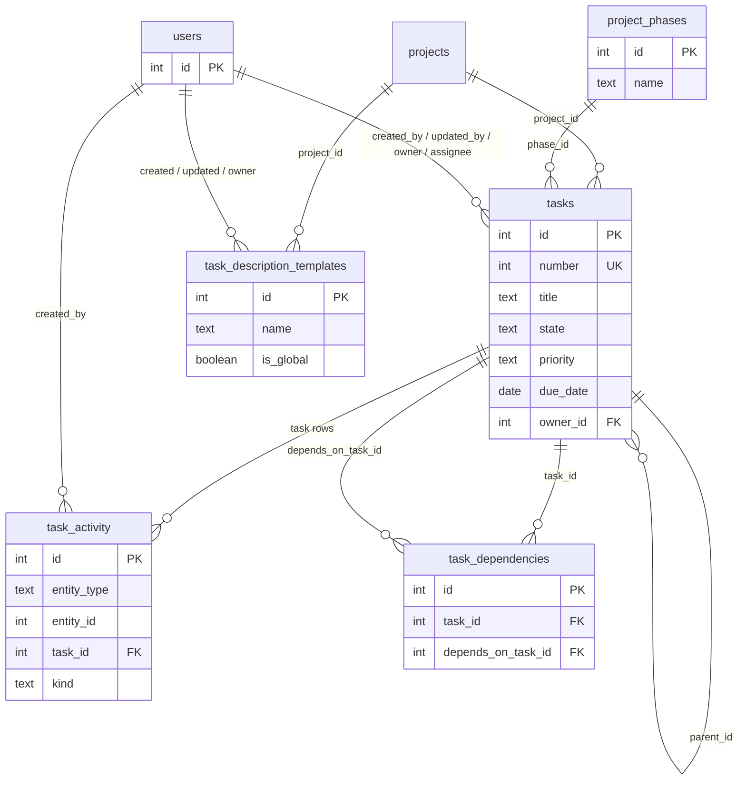

# Tasks

Task records, timeline activity, blocking dependencies, and reusable description templates. Source: [`src/db/schema.ts`](../../src/db/schema.ts).

Collapsed parent tasks in List View are per-user UI state on [`user_task_list_state`](platform.md), not a column on `tasks`.

Related: [overview](overview.md) · [projects and ideas](projects-and-ideas.md) · [glossary](glossary.md)

## Logical model

---

## `tasks`

Work items. May be project-scoped or live only in lists / unsorted (`project_id` null). Display number → **T####**.

Hierarchy (`parent_id`) is separate from **Depends on** edges in `task_dependencies`.

### Columns

| Column | Type | Nullable | Default | Notes |
|--------|------|----------|---------|--------|
| `id` | serial | no | — | Primary key |
| `project_id` | integer | yes | — | FK → `projects.id`; null = unsorted / list-only |
| `phase_id` | integer | yes | — | FK → `project_phases.id`; null = no phase. Not used for list grouping |
| `parent_id` | integer | yes | — | Self-FK → `tasks.id` (subtask tree) |
| `number` | integer | no | — | App-wide unique display number (T####) |
| `title` | text | no | — | |
| `description` | text | yes | — | Markdown body |
| `state` | text | no | `'new'` | See [task states](glossary.md#task-states). When `state_manual` is false and `rollup_total` is set, this value is derived from descendant leaves and is read-only |
| `state_manual` | boolean | no | `false` | When true, `state` stays hand-set. When false, a parent with counted leaves takes a derived status |
| `rollup_done` | integer | yes | — | Count of `complete` leaves. Null when this task has no counted leaves |
| `rollup_total` | integer | yes | — | Counted leaves: non-deleted, non-canceled tasks with no children of their own, anywhere under this task |
| `priority` | text | no | `'none'` | `none` \| `low` \| `medium` \| `high` \| `urgent` |
| `due_date` | date | yes | — | Date-only (`YYYY-MM-DD` string mode in Drizzle) |
| `due_at` | timestamptz | yes | — | **Deprecated**; prefer `due_date` |
| `color` | text | yes | — | Accent (CSS hex string in app) |
| `sort_order` | integer | no | `0` | Manual List View order among siblings. Groups and column sort take precedence in the UI; drag-and-drop writes this field and clears column sort so the drop position sticks. |
| `created_by_id` | integer | no | — | FK → `users.id` |
| `updated_by_id` | integer | no | — | FK → `users.id` |
| `owner_id` | integer | no | — | FK → `users.id` — record owner (T0112); unsorted tasks rely on this |
| `assignee_id` | integer | yes | — | FK → `users.id` — assigned user (T0117); distinct from ownership. When `project_id` is set, must be Project Owner, Manager, or Member (not Viewer). Null when unassigned or unscoped. |
| `created_at` | timestamptz | no | `now()` | |
| `updated_at` | timestamptz | no | `now()` | |

### Constraints

- **PK:** `id`
- **UNIQUE:** `number`
- **FK:** `project_id` → `projects.id` · **ON DELETE CASCADE**
- **FK:** `phase_id` → `project_phases.id` · **ON DELETE SET NULL**
- **FK:** `parent_id` → `tasks.id` · **ON DELETE SET NULL**
- **FK:** `created_by_id` → `users.id` · **ON DELETE RESTRICT**
- **FK:** `updated_by_id` → `users.id` · **ON DELETE RESTRICT**
- **FK:** `owner_id` → `users.id` · **ON DELETE RESTRICT**
- **FK:** `assignee_id` → `users.id` · **ON DELETE SET NULL**
- **INDEX:** `assignee_id`
- **CHECK:** `tasks_rollup_pair` — `rollup_done` and `rollup_total` are both null, or both set with `0 <= rollup_done <= rollup_total` and `rollup_total > 0`

Parent status (T0335) is computed from descendant **leaf** tasks. Canceled and deleted tasks are not counted. Intermediate groups are not items in the fraction; they receive the same kind of rollup from their own leaves. Precedence: all Complete → Complete; any Blocked → Blocked; any In Progress, Pending, or Complete → In Progress; any On Hold → On Hold; any Draft → Draft; otherwise Ready. A task with no counted leaves keeps its stored status. Turning on `state_manual` stops the derived write but still refreshes the counts.

---

## `task_activity`

Append-style timeline for any record: user **comments** and auto-recorded **field changes**. Rows are keyed by `(entity_type, entity_id)`, the same polymorphic pair used by `entity_links`.

Task History still reads and writes this table. A task row keeps `task_id` equal to `entity_id` so deleting a task cascades its timeline. ToDo, Project, Document, and ToDo List rows leave `task_id` null. Deleting those records runs a database trigger that removes their activity. A ToDo List stores its own comments. Its last update is still the newest state or progress change among its ToDo and Task members, not a row on the list. Writers may post and edit comments. Only an Administrator may delete a comment.

Mesh reads the latest `state`, `progress`, `status`, or `body` change as **last update**, and the latest comment separately. A comment does not count as the update. Document `body` changes store the field name only, not the old or new markdown.

### Columns

| Column | Type | Nullable | Default | Notes |
|--------|------|----------|---------|--------|
| `id` | serial | no | — | Primary key |
| `entity_type` | text | no | — | One of the ten record types (`idea`, `project`, `task`, `todo`, `document`, `todo_list`, `board`, `canvas`, `wiki_node`, `image_board`) |
| `entity_id` | integer | no | — | Id of that record. No foreign key, because the type varies |
| `task_id` | integer | yes | — | Set only when `entity_type` is `task`, and then equal to `entity_id`. FK → `tasks.id` |
| `kind` | text | no | — | `comment` \| `change` |
| `body` | text | yes | — | Comment Markdown; also used for session `summary` text |
| `edited_at` | timestamptz | yes | — | Last edit time for comments |
| `field` | text | yes | — | Change rows: field name; session summaries use `summary`. Task state changes also store a `state` row beside the summary |
| `old_value` | text | yes | — | Display before value. Null for document body edits |
| `new_value` | text | yes | — | Display after value. Null for document body edits |
| `created_by_id` | integer | yes | — | FK → `users.id`; null on some legacy rows |
| `source` | text | no | `'api'` | `ui` when SPA sends `X-TaskMesh-Client: ui`; else `api` |
| `created_at` | timestamptz | no | `now()` | |

### Constraints

- **PK:** `id`
- **INDEX:** `(entity_type, entity_id, created_at)` — `task_activity_entity_idx`
- **CHECK:** `entity_type` is one of the ten record types — `task_activity_entity_type_chk`
- **CHECK:** task rows have `task_id = entity_id`; every other type has `task_id` null — `task_activity_task_link_chk`
- **FK:** `task_id` → `tasks.id` · **ON DELETE CASCADE**
- **FK:** `created_by_id` → `users.id` · **ON DELETE SET NULL**
- **TRIGGER:** after delete on `todos`, `projects`, `project_documents`, and `todo_lists`, `purge_entity_activity` removes matching rows

---

## `task_dependencies`

Directed blocking edges: row means **`task_id` depends on `depends_on_task_id`**. Inverse view in the UI is “Required by”.

### Columns

| Column | Type | Nullable | Default | Notes |
|--------|------|----------|---------|--------|
| `id` | serial | no | — | Primary key |
| `task_id` | integer | no | — | Dependent task |
| `depends_on_task_id` | integer | no | — | Blocker task |
| `created_at` | timestamptz | no | `now()` | |

### Constraints

- **PK:** `id`
- **UNIQUE:** `(task_id, depends_on_task_id)` — `task_dependencies_pair_uidx`
- **FK:** `task_id` → `tasks.id` · **ON DELETE CASCADE**
- **FK:** `depends_on_task_id` → `tasks.id` · **ON DELETE CASCADE**

---

## `task_description_templates`

Reusable Markdown bodies for task descriptions. May be project-scoped or **global** (`is_global`).

### Columns

| Column | Type | Nullable | Default | Notes |
|--------|------|----------|---------|--------|
| `id` | serial | no | — | Primary key |
| `name` | text | no | — | |
| `body` | text | no | — | Markdown template |
| `project_id` | integer | yes | — | Null when saved from unsorted / non-project task |
| `is_global` | boolean | no | `false` | When true, available on all tasks |
| `created_by_id` | integer | yes | — | FK → `users.id` |
| `updated_by_id` | integer | yes | — | FK → `users.id` |
| `owner_id` | integer | no | — | FK → `users.id` — creator-owned (T0112); global templates still scoped to owner |
| `created_at` | timestamptz | no | `now()` | |
| `updated_at` | timestamptz | no | `now()` | |

### Constraints

- **PK:** `id`
- **FK:** `project_id` → `projects.id` · **ON DELETE CASCADE**
- **FK:** `created_by_id` → `users.id` · **ON DELETE SET NULL**
- **FK:** `updated_by_id` → `users.id` · **ON DELETE SET NULL**
- **FK:** `owner_id` → `users.id` · **ON DELETE RESTRICT**
